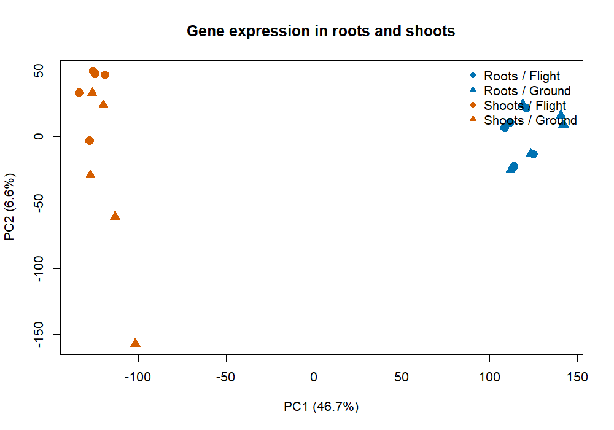
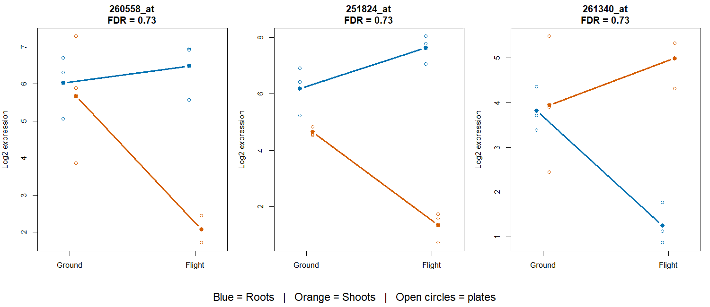

## Abstract

This project examined whether roots and shoots of *Arabidopsis thaliana*
responded differently to spaceflight at the gene-expression level.
The analysis used 20 microarray samples from the public dataset
GSE56659, with five samples in each tissue and flight-condition group.
Principal component analysis was used to explore overall expression
patterns. A plate-level limma model tested whether the flight-minus-ground
change in expression differed between roots and shoots. Of the 22,810
probes tested, none met the 5% false discovery rate threshold. With
three plates per condition, the analysis provides limited evidence
for estimating tissue-specific responses.

## Introduction

Plant roots and shoots perform different functions. Roots take up
water and nutrients, while shoots contain the leaves that capture
light for photosynthesis. Because the two tissues have different
roles, they may also respond differently when plants grow in an
unfamiliar environment.

Paul et al. (2013) studied how *Arabidopsis thaliana* responds to
spaceflight by comparing plants grown aboard the International Space
Station with ground controls. The publicly available microarray data
allow us to examine the expression patterns of individual tissues.

This reanalysis focuses on one question: **Does the change in gene
expression from ground control to spaceflight differ between roots
and shoots?** To answer it, the analysis compares the flight-minus-ground
change in roots with the corresponding change in shoots for each
microarray probe.

## Data and Methods

### Dataset and sample selection

The expression data came from the public NCBI Gene Expression Omnibus
dataset [GSE56659](https://www.ncbi.nlm.nih.gov/geo/query/acc.cgi?acc=GSE56659).
This analysis used 20 Arabidopsis thaliana microarray samples. There
were five samples in each of four groups: flight roots, ground-control
roots, flight shoots, and ground-control shoots.

### Data preparation and exploratory analysis

The processed expression matrix was imported into R using GEOquery.
Probes with non-finite values in any of the selected samples were
excluded. The expression values were transformed to the log₂ scale.
Principal component analysis (PCA) was applied to the 20 samples to
explore whether they grouped by tissue type or flight condition.

### Statistical analysis

The selected samples came from plates numbered 2, 4, and 6 in each
condition. When a plate contributed more than one measurement for the
same tissue, those measurements were averaged on the log₂ scale.
For each probe, shoot expression was then subtracted from root
expression within each plate.

A limma linear model compared these root–shoot differences between
flight and ground while accounting for plate number. This tested
whether the flight-minus-ground change differed between the two
tissues. P-values were adjusted across probes using the
Benjamini–Hochberg method, with a false discovery rate threshold
of 0.05.

## Results

### Principal component analysis

Principal component analysis (PCA) was performed on the log₂-transformed
expression values for the 20 samples. Each point represents one sample.
Colour indicates tissue type (roots or shoots), and shape indicates
condition (spaceflight or ground control). The first principal component
(PC1) explained [PC1]% of the total variation, and the second principal
component (PC2) explained [PC2]%.

### Tissue-specific response to spaceflight

The plate-level limma analysis tested 22,810 microarray probes for
differences between the flight response in roots and the flight response
in shoots. No probes met the 5% false discovery rate threshold after
Benjamini–Hochberg correction.

| Probe ID | Interaction estimate (log₂ scale) | Raw p-value | Adjusted p-value |
|---|---:|---:|---:|
| 260558_at | 4.054 | 0.000178 | 0.731 |
| 251824_at | 4.741 | 0.000313 | 0.731 |
| 261340_at | −3.611 | 0.000353 | 0.731 |

A positive estimate means the flight-minus-ground change was more
positive in roots than in shoots. A negative estimate means it was
more positive in shoots than in roots.

*The open circles show individual plate averages. The filled circles
and lines show the mean for each tissue and condition. These three
probes are exploratory examples selected by their ranking.*

## Discussion

The analysis did not detect a tissue-specific flight response at
FDR < 0.05. The three top-ranked probes had small raw p-values, but
their adjusted p-values were about 0.731 after accounting for the
22,810 tests. The comparison used three plate-level observations per
condition, which limited the ability to detect differences. The
results therefore leave open the possibility that some probes respond
differently in roots and shoots.

## Conclusion

This study examined whether roots and shoots of Arabidopsis thaliana
responded differently to spaceflight at the gene-expression level.
Of the 22,810 microarray probes tested, none met the 5% false discovery
rate threshold for a difference between the two tissue responses.
With three plates per condition, the analysis leaves open the
possibility of tissue-specific responses that a larger study could detect.

## References

1. NCBI Gene Expression Omnibus. [GSE56659 dataset](https://www.ncbi.nlm.nih.gov/geo/query/acc.cgi?acc=GSE56659).
2. Paul, A.-L., Zupanska, A. K., Schultz, E. R., & Ferl, R. J. (2013).
   Organ-specific remodeling of the Arabidopsis transcriptome in response
   to spaceflight. *BMC Plant Biology*, 13, 112.
   [Article](https://doi.org/10.1186/1471-2229-13-112)
3. Ritchie, M. E., et al. (2015). limma powers differential expression
   analyses for RNA-sequencing and microarray studies.
   *Nucleic Acids Research*, 43(7), e47.
   [Article](https://doi.org/10.1093/nar/gkv007)
